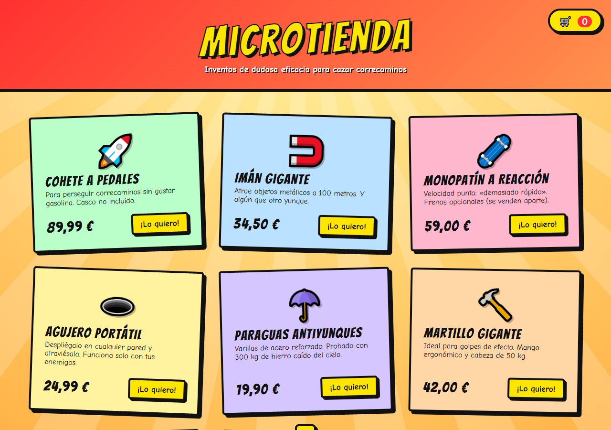
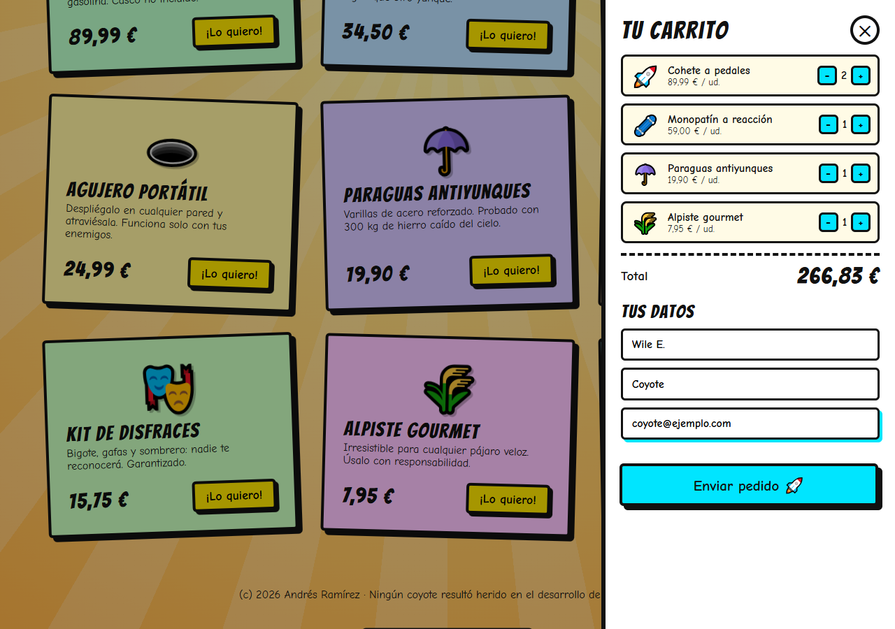
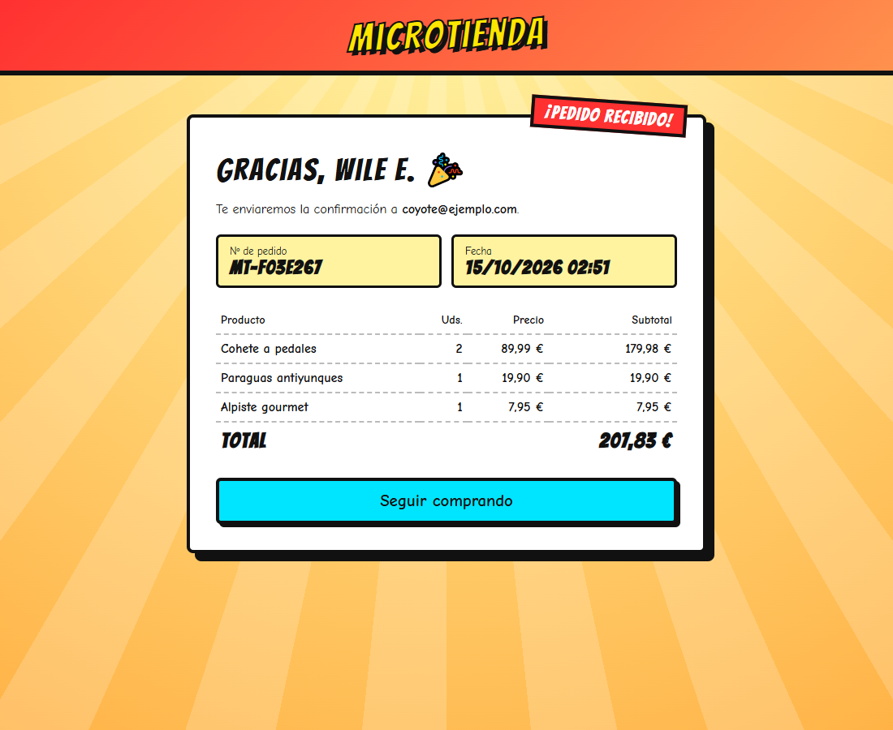

# Microtienda

Tienda online con estilo de dibujos animados, hecha con **PHP, MySQL y JavaScript**: catálogo cargado desde la base de datos, carrito con cantidades y pedidos que se guardan de verdad.



| Carrito y datos del cliente | Confirmación del pedido |
| --- | --- |
|  |  |

## Características

- **Catálogo dinámico**: los productos, precios e iconos salen de MySQL.
- **Carrito lateral** con cantidades, total en vivo y animaciones. Se guarda en `localStorage`, así que no se pierde al recargar la página.
- **Pedido real**: se envía a una pequeña API en PHP (`api/pedido.php`) en JSON y se guarda en las tablas `pedidos` y `lineas_pedido` dentro de una **transacción**.
- **Página de confirmación** con número de pedido, líneas y total.
- Validación en el servidor con mensajes de error junto a cada campo.
- Diseño cartoon adaptable a móvil: tipografía *Bangers*, sombras duras, rayos de fondo y tarjetas ligeramente giradas.

## Seguridad y buenas prácticas

- **El navegador nunca decide el precio**: solo envía ids y cantidades, y el servidor calcula el total con los precios de la base de datos. Si alguien modifica el precio en el navegador, el pedido se guarda con el precio real.
- Cada línea guarda el nombre y el precio **del momento de la compra**, así un pedido antiguo no cambia aunque luego se modifique el producto.
- Consultas preparadas con PDO, salida escapada con `htmlspecialchars` y el carrito pinta los datos con `textContent`.
- El usuario de la base de datos solo tiene permisos `SELECT` e `INSERT`.

## Tecnologías

PHP 8 · MySQL / MariaDB · PDO · JavaScript (Fetch API, localStorage) · HTML · CSS

## Cómo ejecutarlo

Requisitos: PHP 8.1+ con `pdo_mysql` y MySQL o MariaDB (sirve XAMPP).

```bash
git clone https://github.com/Ramizzz8/microtienda.git
cd microtienda
mysql -u root -p < database/schema.sql
php -S localhost:8000
```

Abre <http://localhost:8000>. Los datos de conexión están en [`includes/db.php`](includes/db.php) y se pueden cambiar con las variables `TIENDA_DB_HOST`, `TIENDA_DB_NAME`, `TIENDA_DB_USER` y `TIENDA_DB_PASS`.

## Autor

**Andrés Ramírez** — [GitHub](https://github.com/Ramizzz8) · [LinkedIn](https://www.linkedin.com/in/andr%C3%A9s-ram%C3%ADrez-011936349/)
